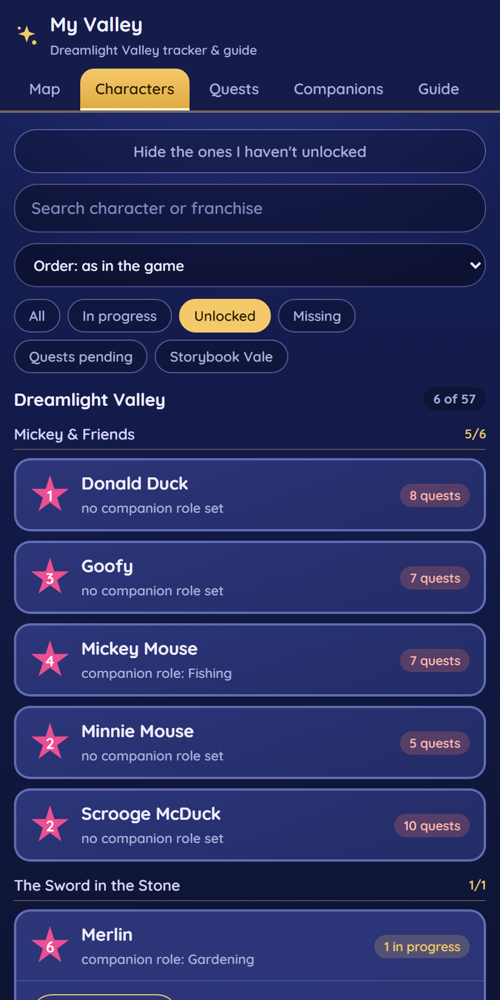

# Dreamlight Valley Tracker

A phone-first tracker and offline guide for **Disney Dreamlight Valley** players: tick the areas, characters, friendship quests and critters you have unlocked, and look up 1,400+ recipes, ingredients, fish, crops and shops, including which dishes actually make a profit.

> Unofficial fan tool. Not affiliated with Disney or Gameloft.

**Live demo:** https://marianaciaparini.github.io/dreamlight-valley-tracker/ (saves only in your browser until you connect a spreadsheet)

## Setup in 5 minutes

1. Open the demo link above, or download `index.html` and double-click it. There is nothing to install or build.
2. On a phone, add it to the home screen (Safari: Share → Add to Home Screen; Chrome: ⋮ → Add to Home screen).
3. Tick what you have in the **Map**, **Characters**, **Quests** and **Companions** tabs.
4. Optional, to keep your progress safe and shared between phone and computer: follow [apps-script/README.md](apps-script/README.md) to create your own Google Sheet backend, then paste its URL and password in **Progress → Connect to my spreadsheet**.
5. Either way, **Progress → Copy backup** gives you a text backup you can paste back at any time.

## How it works

- One static file, `index.html`: vanilla JavaScript and CSS, no framework, no build step, no dependencies.
- All game data lives in plain arrays inside the file; on load they are flattened into one searchable index for the Guide tab.
- State is a small JSON object saved to `localStorage` and, if configured, to a Google Apps Script web app that stores it as text in the user's own Google Sheet, with hourly restore points.
- Hosted on GitHub Pages. `tests/smoke.py` (Python + Playwright) runs the page in headless Chromium before every commit.

## Technical decisions & what I learned

- **Don't trust browser storage alone.** iOS can purge `localStorage` for home-screen apps that go unused, and I lost real progress to it. That is why the optional spreadsheet backend exists, with a "which side has more data?" prompt before any overwrite and an "Undo the last sync" button.
- **Apps Script answers POSTs from a redirected origin, so the browser often can't read the response even when the write worked.** Instead of trusting the response, the app writes, reads the data back and compares.
- **Every bug that reached me became a test.** The smoke test checks things that really broke once: a CSS rule that showed two tabs at once, a restore that was silently undone on reload, an apostrophe that broke the script, a schedule parser that double-counted days.
- **Profit has to count what the ingredients are worth raw.** An early version treated fish and pantry items as free and overstated profits by 2–3×; the calculator now subtracts the sell value of every ingredient and fills "any vegetable" slots with the cheapest option.

## Known limitations

- Gift preferences are documented for only about 27 characters.
- Main-story and realm quests are not tracked yet; only friendship quests and some item quests.
- Recipes from the newest expansions have ingredients and stars but no sell price or energy.
- A few locations and companion schedules are flagged in the text as unconfirmed, because sources disagree.
- The spreadsheet password protects the data only lightly (it travels in the request); fine for a game tracker, not for anything sensitive.
- The code still has some Portuguese identifiers from when it was a personal project.

## License

Code: [MIT](LICENSE). Game data: [CC BY-NC-SA 4.0](DATA-LICENSE.md), because part of it is adapted from the Dreamlight Valley Wiki.
